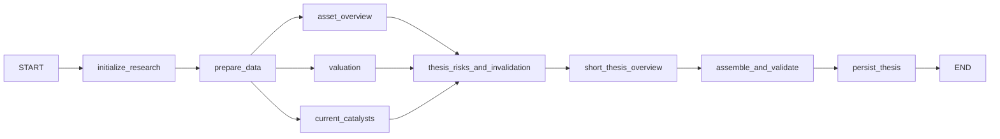
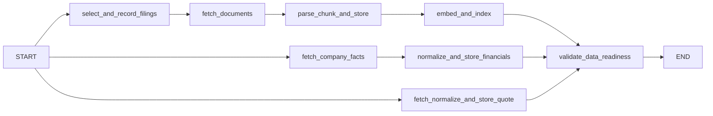

# Thesis Mode v1 LangGraph workflow

This is the **planned** execution design for the existing
[`AssetThesisService`](../app/services/asset_thesis_service.py) and
[`StockAssetThesis`](../app/domain/schemas/asset_thesis.py) contract. The parent
topology is compiled, but its child graphs and analysis nodes are unfinished;
the Thesis endpoint still returns 501. It starts from
the stock-only `AssetThesisRequest`, independent of Snapshot's router. A
same-asset Snapshot may add background context but is never
required or a substitute for source evidence.

## Scope and state

V1 covers US nonfinancial companies reporting under US GAAP in USD, with
positive, reasonably stable cash flows and simple capital structures. Banks,
insurers, REITs, loss-making businesses, and complex turnarounds are outside
scope. The fixed research boundary is the latest SEC 10-K, the latest 10-Q filed
after it, relevant 8-K filings and available HTML exhibits in the preceding 90
days, SEC Company Facts for three complete financial years and required balance
sheet inputs, and one price source. Selection and quote timestamps must respect
the execution's fixed `as_of`; the existing yfinance integration can supply the
quote where suitable. Catalysts come from disclosures in this corpus. There is
no separate news, peers, analyst estimates, macro, or general IR/PDF feed.

The parent graph owns one `ThesisState` per research execution. It holds asset
identity, `research_id`, a fixed `as_of`, prepared-data references and versions,
bounded analytical results, and the assembled final response. It is workflow
state, not an application-wide mutable global. Large filing text and embeddings
stay in document and index storage. `ThesisState` is distinct from the public
`StockAssetThesis` response and from business persistence records.

| Step / state owner | Explicit input | Output or parent-state update |
| --- | --- | --- |
| `initialize_research` / parent | `AssetThesisRequest` | Asset identity, `research_id`, fixed `as_of`, optional Snapshot context |
| `prepare_data` / `ThesisDataPreparation` | Identity, `as_of`, known artifact versions | Typed prepared-data result: filing/index, financial, and quote references; coverage and data gaps |
| Three analysis branches / parent | Prepared references; versioned DCF policy | Separate `asset_overview`, `valuation`, and `current_catalysts` fields |
| Risk and summary nodes / parent | Completed branch results; targeted evidence | `thesis_risks_and_invalidation`, then `short_thesis_overview` |
| Assembly and persistence / parent | All results, coverage, evidence IDs | Validated `StockAssetThesis` in final-response field; saved artifact reference |

Complex subgraphs, especially `ThesisDataPreparation`, own internal state. They
receive explicit parent inputs and return selected updates; their intermediate
fetch, parse, and indexing details are not automatically merged into the parent.
Use wrapper nodes where input/output mapping is needed. Simple nodes can read
and update `ThesisState` directly; a separate state schema for every node adds
no value.

## Main graph

The three incoming branches form an **all-branch join**: in LangGraph terms,
`thesis_risks_and_invalidation` must depend on the list of all three source
nodes, rather than run once per arriving edge. Logical fan-out does not require
simultaneous LLM requests; start with inference concurrency limited to one.
Each branch writes its own result field. Add an explicit reducer only if
multiple branches must write the same collection.

`asset_overview` retrieves relevant business and financial passages, then
generates a structured overview. `current_catalysts` retrieves recent disclosures
and generates grounded event findings; an empty list is valid when no qualifying
event is disclosed. These can be small retrieval-then-generation subgraphs with
their own state only where the two stages need intermediate values. `valuation`
uses prepared financials and versioned rules to derive forecast assumptions,
then applies configured WACC and terminal growth in one five-year FCFF DCF plus
terminal value. Python calculates values and sensitivity; LLMs explain evidence
and uncertainty, never financial arithmetic or automatic WACC estimates.

`thesis_risks_and_invalidation` combines all three branch results with targeted
retrieval to describe observable risks, explicit uncertainties, affected
assumptions, and reassessment signals. `short_thesis_overview` synthesizes the
investment thesis and valuation conclusion. `assemble_and_validate` builds all
six public sections—Short Thesis Overview, Asset Overview, Valuation, Current
Catalysts, Thesis Risks & Invalidation, and Sources / Evidence—then resolves
claim-level evidence IDs and checks schema and cross-section consistency.
`persist_thesis` stores the validated research artifact. There is no separate
Risk Discovery stage, mandatory reconciliation stage, or automatic DCF revision
loop. Material unsupported assumptions or conflicts may yield `uncertain` as a
completed research judgment; execution failure is a separate error.

## Data preparation subgraph

The filings branch records the selected accession numbers and document versions
before fetching. It stores documents and chunks, then embeds and indexes the
available HTML. The financial branch normalizes SEC Company Facts and the
required balance-sheet inputs. The quote branch records one normalized price
and its timestamp. `validate_data_readiness` waits for all three branches and
returns a typed prepared-data result containing artifact references, versions,
coverage, and explicit gaps. It can report missing source facts without treating
them as a successful retrieval of complete data. Eligibility and essential
inputs are checked before analysis proceeds. Reuse compatible stored artifacts;
process only missing or changed inputs. This ingestion/indexing step is separate
from retrieval and generation in the analytical branches.

## Execution and recovery

Use a persistent parent checkpointer and a stable research `thread_id` for
resume; nested subgraphs inherit checkpointing through the parent. Freeze the
`as_of`, selected source and artifact versions, and assumption configuration for
the run so a resume cannot silently mix newer filings or prices into prior
results. Make document, chunk, index, and final artifact writes idempotent under
stable source/version keys. Retry transient fetch, retrieval, indexing, and model
failures within bounds; surface exhausted technical failures separately from
unavailable evidence and from a completed `uncertain` thesis. Checkpoints
recover execution progress. Business persistence stores the validated thesis for
later use; the two stores have different lifecycles.
